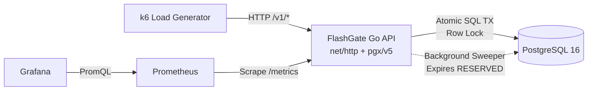
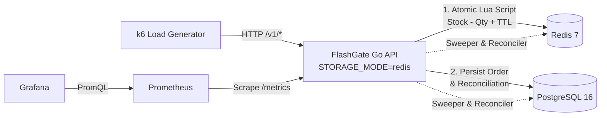

# FlashGate — Architecture Overview

Dokumen ini menjelaskan topologi layanan dan evolusi arsitektur FlashGate dari **Fase Baseline (PostgreSQL-only)** ke **Fase Optimasi (Redis + PostgreSQL Reconciliation)**.

## 1. Fase Baseline (PostgreSQL-Only — Fase 3)
Seluruh pembacaan dan pemotongan stok atomik dieksekusi langsung di PostgreSQL 16 melalui `pgx/v5`. Tujuan fase ini adalah menjamin 0% overselling dan memetakan batas *lock contention* database.

## 2. Fase Optimasi (Redis Atomic Reservation + Postgres Reconciliation — Fase 4)
Garda depan pemotongan stok dipindahkan ke Redis menggunakan *Lua script* atomik dengan TTL. PostgreSQL tetap menjadi *source of truth* jangka panjang untuk *order* dan audit *correctness*.

## 3. Batas Modul Internal (Dependency Rule)
Perpindahan antara mode `postgres` dan `redis` dikendalikan lewat *environment variable* `STORAGE_MODE` di belakang satu *interface* `OrderRepository`:

- `cmd/api`: *Wiring* dependensi, HTTP server, *graceful shutdown* (SIGINT/SIGTERM).
- `internal/domain`: Struct `Event`, `Order`, konstanta status, dan *sentinel errors*. **Nol import paket eksternal.**
- `internal/service`: Aturan bisnis, validasi jendela waktu *event*, orkestrasi *sweeper*. Hanya bergantung pada `domain` dan *interface* repository.
- `internal/repository/postgres`: Implementasi SQL atomik (`pgxpool`).
- `internal/repository/redis`: Implementasi *Lua script* + sinkronisasi Postgres (Fase 4).
- `internal/transport/http`: *Handler* `net/http`, middleware *request ID*, *structured logging* (`log/slog`), dan pencatatan metrik RED.
- `internal/observability`: Registrasi metrik Prometheus dan eksposur stat `pgxpool`.

## 4. Topologi Container (`docker-compose.yml`)
Seluruh komponen berjalan dalam satu *bridge network* terisolasi (`flashgate-net`):
- `api` (port `8080`): Go *static binary* (*non-root*), bergantung pada `postgres` (`service_healthy`).
- `postgres` (port `5432`): `postgres:16-alpine` dengan *named volume* dan *healthcheck* `pg_isready`.
- `redis` (port `6379`, aktif mulai Fase 4): `redis:7-alpine` dengan *healthcheck* `redis-cli ping`.
- `prometheus` (port `9090`): *Scrape* `/metrics` dari `api:8080` setiap 5 detik.
- `grafana` (port `3000`): *Auto-provisioned* datasource Prometheus dan dashboard FlashGate.
