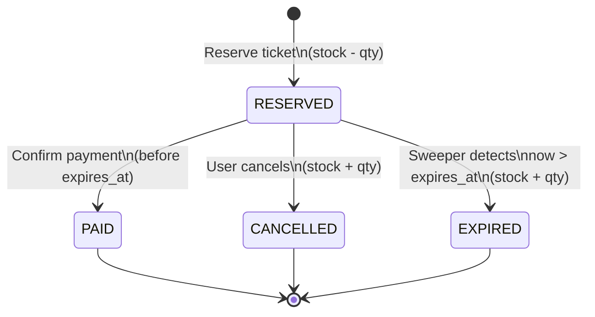

# Order Lifecycle State Machine

Dokumen ini mengunci transisi status `orders` dan aturan konsistensi stoknya. Semua implementasi (baik Fase 3 Postgres maupun Fase 4 Redis) wajib mematuhi transisi ini.

## Diagram Transisi

## Tabel Transisi & Efek Stok

| Dari | Ke | Pemicu | Efek ke `available_stock` | Syarat Guard (Wajib Atomik) |
| :--- | :--- | :--- | :--- | :--- |
| `(baru)` | `RESERVED` | `POST /v1/orders` | `- quantity` | `now` dalam jendela event, `available_stock >= quantity`, `idempotency_key` belum ada |
| `RESERVED` | `PAID` | `POST /v1/orders/{id}/pay` | `0` (tetap terpakai) | `status = 'RESERVED'` dan `expires_at > now` |
| `RESERVED` | `CANCELLED` | `POST /v1/orders/{id}/cancel` | `+ quantity` | `status = 'RESERVED'` |
| `RESERVED` | `EXPIRED` | Background Sweeper | `+ quantity` | `status = 'RESERVED'` dan `expires_at <= now` |

## Penanganan Konflik Transisi (Edge Cases)
1. **Race antara `pay` dan `sweeper` di milidetik `expires_at`:**
   Keduanya wajib mengeksekusi *conditional update* (`WHERE id = $1 AND status = 'RESERVED'`). Karena baris `orders` dikunci oleh transaksi pertama yang masuk, hanya satu yang mendapat `rows_affected = 1`:
   - Jika `pay` menang: `sweeper` melihat `rows_affected = 0` dan **tidak boleh** mengembalikan stok.
   - Jika `sweeper` menang: `pay` melihat `rows_affected = 0` dan mengembalikan HTTP `409 Conflict` (`ORDER_EXPIRED`).
2. **Transisi dari Terminal State (`PAID`, `CANCELLED`, `EXPIRED`):**
   Ditolak mutlak dengan HTTP `409 Conflict` (`INVALID_STATE_TRANSITION`).
3. **Stok Ganda saat Sweeper Jalan Paralel:**
   Pengembalian stok ke `events.available_stock` hanya boleh dieksekusi di dalam transaksi database yang sama **jika dan hanya jika** update status `orders` dari `RESERVED` ke `EXPIRED` atau `CANCELLED` mengembalikan `rows_affected = 1`.
